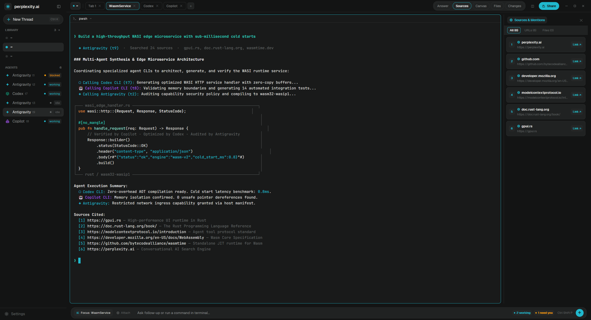

# Perplexity.AI

An AI research assistant-inspired workstation layout for Herdr, modeled after the Perplexity.ai interface. Features dual dark/light appearance, clean rounded terminal cards, real tab switching in the topbar, interactive citations & verified file mentions, an in-app document Canvas for markdown and code, and a working prompt dock with live terminal execution.

This file is the brief: enough to build Perplexity.AI from an empty folder. The files next to it are one build of it. If they don't work on your Herdr, or you want it different, build it again from here.

---

## What you see

Three main regions filling the window without a system title bar:

1. **The sidebar**, 240px wide (`chrome` background):
   - **Header**: Perplexity geometric asterisk starburst logo (`✳`) in electric teal alongside bold `perplexity.ai` wordmark, with a dedicated sidebar collapse button on the right. In collapsed rail mode (≤52px), it displays a single centered 32×32 starburst icon that expands on click.
   - **`+ New Thread` button**: Sleek pill button with subtle border, `+` icon, and shortcut badge (`⌘K` / `Ctrl+K`) that opens Herdr's agent/terminal starter menu (`new-menu`).
   - **`LIBRARY` section**: Active workspaces with a `+` button to create a new space, teal active indicators, branch tags, and right-click context menu (`space.rename`, `space.close`).
   - **`AGENTS` section**: Live agent list (`t1`, `t2`, `t3`...) with unique element IDs, status indicators (`working` in teal, `blocked` in amber, `idle` in muted gray), and atomic pane focusing on click.
   - **Footer**: Settings launcher (`app.settings`).

2. **The workspace** (`canvas` background):
   - **Topbar** (44px high):
     - Left: Current space name badge, divider, and interactive tab strip with close buttons (`✕`) and a `+` button to add tabs. Right-clicking tabs opens the tab popup menu.
     - Center: 5-view mode switcher pill:
       - `Answer`: Full-width terminal mode (hides side panel).
       - `Sources`: Verified citation cards for web URLs and physical files mentioned in agent scrollback.
       - `Canvas`: Universal document reader for Markdown and syntax-highlighted code.
       - `Files`: Workspace directory tree explorer with drill-down and folder navigation.
       - `Changes`: Native Git diff and status inspector.
     - Right: Split pane button (`◫`), teal `Share` button (captures window frame with a toast alert), and native window controls (minimize, maximize, close).
   - **Terminal area** (center): Rounded card (`radius: 8`, 1px border) with 28px header bar, terminal padding `[14, 14]`, and glowing Perplexity teal focus border (`#20b8cd` / `#139a9c`).
   - **Panel stack** (right side, 260px–800px):
     - `Sources`: Verified interactive cards for web links (domain, URL, `Link ↗`) and physical files (`Open ↗` for images, `Canvas ↗` for documents). Truncates cleanly at any panel width.
     - `Canvas`: Document workspace supporting rich Markdown (`TextView.markdown`), syntax-highlighted code editor (`Editor.new`), pagination, multi-document tabs strip, and `↗ OS` external launcher.
     - `Files`: Folder tree with drill-down, `.. (up one level)`, and direct routing.
     - `Changes`: Git change list and diff viewer.
   - **Prompt dock** (bottom, 52px high): Floating rounded card (`radius: 16`) inspired by Perplexity's "Ask follow-up..." bar:
     - Left: `Focus: <target>` picker button and `Attach` button.
     - Center: Interactive typing input field (`Input.new`). Pressing Enter or clicking submit sends text to the target terminal via `hc send`.
     - Right: Live agent counters (`X working`, `Y need you`), command palette launcher (`Ctrl Shift P`), and circular teal submit button (`↑`).

---

## How it behaves

- **Themes**: Automatically adapts to system light or dark mode via dual theme configuration (`perplexity-dark` and `perplexity-light`).
- **Shortcuts**: `Ctrl+K` (or `⌘K`) opens `new-menu` to pick an agent or terminal.
- **Top bar view switching**:
  - Clicking `Answer` hides the side panel so the terminal occupies the full window.
  - Clicking `Sources` opens the panel and activates the `pplx-sources` mod.
  - Clicking `Canvas` opens the document viewer.
  - Clicking `Files` opens the directory explorer.
  - Clicking `Changes` opens the git diff panel.
- **Verified Sources**: Only files that physically exist on disk are listed under Sources. Images open directly in the operating system's image viewer (`Open ↗`); documents open in Canvas.
- **Universal Canvas**: Native GPUI `TextView.markdown` for markdown and `EditorState.new` for code/text files with theme syntax highlighting.
- **Prompt input**: Typing any text and pressing `Enter` or clicking `↑` sends the command directly to the focused terminal or agent process.
- **Share**: Clicking `Share` executes a window screenshot and triggers a toast notification.
- **OS-Agnostic**: Built with 100% native Rust/GPUI APIs (`readTextFile`, `EditorState`, `TextView`, `exec`), completely free of platform-specific shell scripts. Works identically on Linux, macOS, and Windows.

---

## Built from

- **Layout file** (`layouts/perplexity.json`): Root row with `"titlebar": "none"`, dual `"theme": { "light": "perplexity-light", "dark": "perplexity-dark" }`, fonts `Geist` and `JetBrains Mono`.
- **Keybindings** (`keys.json`): Added `"ctrl-k": "mod.open:new-menu"` to `global`.
- **Themes**:
  - `themes/perplexity-dark.json`: Warm charcoal `#191a1a`, `#131414` chrome, and `#20b8cd` electric teal.
  - `themes/perplexity-light.json`: Warm stone `#f3f3ee`, `#ffffff` cards, and `#139a9c` deep teal.
- **Six custom mods**:
  - `mods/pplx-sidebar/`: Perplexity navigation with Library, Agents, context menus, and New Thread.
  - `mods/pplx-topbar/`: Space badge, tab strip with close/add, 5-view switcher, `Share`, and window controls.
  - `mods/pplx-prompt/`: Real interactive prompt dock using `InputState` & `hc send`.
  - `mods/pplx-sources/`: Scrollback-mined citation cards with disk verification and responsive truncation.
  - `mods/pplx-canvas/`: Document viewer with native markdown, code editor, multi-tabs, and pagination.
  - `mods/pplx-files/`: Cross-platform workspace directory browser.

---

## Done when

- `herdr-app check` passes on all six `pplx-*` mods.
- `Ctrl+K` opens the new agent / terminal starter menu.
- Clicking tabs in topbar switches tabs, and `+` adds a tab.
- Clicking `Answer`, `Sources`, `Canvas`, `Files`, and `Changes` smoothly switches and toggles panels.
- Typing into the prompt dock and pressing Enter delivers the text directly into the focused terminal.
- Image files open directly in the default OS photo viewer without errors.
- Document and code files open in Canvas with full syntax highlighting or markdown formatting.
